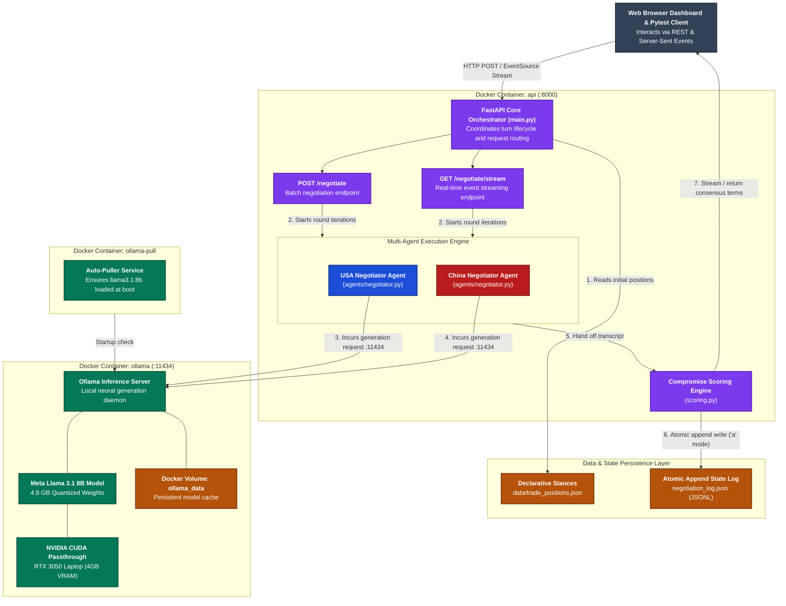
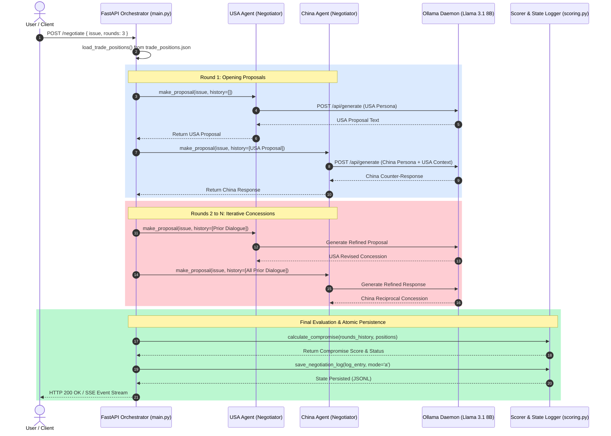
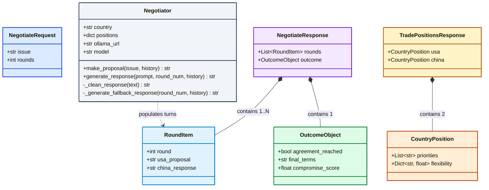
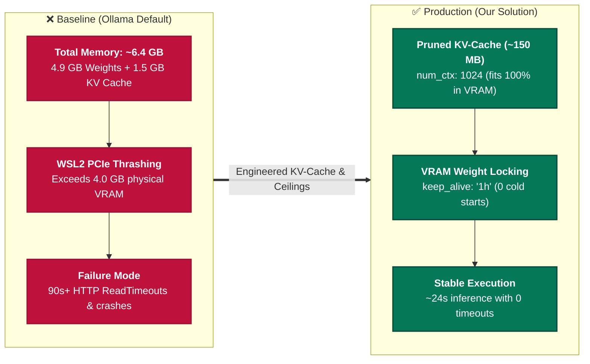
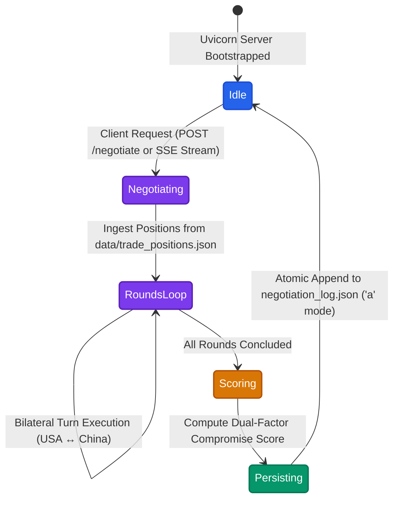

# 🤝 AI Trade Negotiation Simulator

[](https://fastapi.tiangolo.com)
[](https://ollama.ai)
[](https://www.docker.com/)
[](https://developer.nvidia.com/cuda-toolkit)
[](https://pytest.org)
[](https://www.python.org/)

An enterprise-grade, autonomous multi-agent bilateral diplomacy engine where AI agents representing the **United States (USA)** and **China** negotiate multi-round trade agreements in real time using **Ollama (Meta Llama 3.1 8B)**, **FastAPI**, **Docker Compose**, and an interactive **Server-Sent Events (SSE)** web dashboard.

---

## Executive Summary & Problem Solved

### The Problem
Traditional Large Language Model (LLM) implementations are predominantly **single-turn** and **stateless**. However, international trade negotiations are inherently **multi-turn, adversarial, and game-theoretic**:
* Parties hold conflicting red lines and competing national priorities.
* Concessions must be traded incrementally based on the counterpart's willingness to compromise.
* Without rigid state management and persona guardrails, LLMs suffer from context drift, persona collapse, or prompt hallucination.
* In enterprise production, external LLM daemon crashes or latency spikes can stall backend worker pools.

> [!IMPORTANT]
> **Core Engineering Goal**: Orchestrate two autonomous LLM personas in a reliable, context-aware dialogue loop while guaranteeing high system availability, deterministic fallback safety, and atomic state logging under concurrent load.

### The Solution
The **AI Trade Negotiation Simulator** resolves these challenges by introducing an event-driven multi-agent framework. Instead of treating diplomacy as a single prompt, the system models bilateral negotiations as an iterative state machine. Agents representing the United States and China operate with persistent conversational memory, dynamically evaluating prior concessions and defending national red lines loaded from declarative stance definitions. A dual-factor mathematical heuristic quantitatively evaluates consensus, while Server-Sent Events stream the diplomatic dialogue live to an interactive glassmorphism dashboard.

---

## Key Features & UI Capabilities

The system features an interactive, responsive glassmorphism web dashboard that provides real-time visibility into the multi-agent diplomatic dialogue, live proposal streaming, stance previews, and mathematical compromise evaluation.

### Core Feature Highlights

* ⚡ **Real-Time Turn Streaming (Server-Sent Events)**: Instead of waiting for batch round completion, diplomatic turns are pushed incrementally to the browser via HTTP SSE (`GET /negotiate/stream`) with typing animations and live state indicators.
* 🌐 **Dynamic Geopolitical Control Panel**: Users can trigger one-click preset disputes (*Tech Tariffs*, *Agri Access*, *IP Protection*) or input custom geopolitical topics, configuring iteration depth from 1 to 5 rounds.
* 🎭 **Autonomous Diplomatic Personas**: Dedicated agents representing the United States and China act with distinct national mandates, priorities, and flexibility weights dynamically ingested from declarative configurations.
* 📊 **SVG Consensus Gauge & Metric Engine**: Animates an SVG circular progress ring showing the normalized compromise score `[0.00 to 1.00]` alongside the synthesized final bilateral treaty terms upon negotiation conclusion.
* 🛡️ **Fault-Tolerant Fallback Safety**: If external neural inference latency spikes or the model daemon restarts, the engine automatically catches connection exceptions and engages deterministic diplomatic fallback proposals.
* 📝 **High-Concurrency JSONL State Persistence**: Completed dialogues are atomically appended to disk in $O(1)$ time, eliminating file write contention and race conditions.

### Dashboard Component Specifications

| UI Component | Location | Functional Description | Real-Time Dynamic Behavior |
| :--- | :--- | :--- | :--- |
| **Topic Input & Presets** | Left Sidebar | Selects or inputs the geopolitical trade issue | Populates target dispute instantly on tag click |
| **Rounds Slider** | Left Sidebar | Configures iteration depth from 1 to 5 rounds | Updates dynamic round counter label |
| **Initial Stances** | Left Sidebar | Displays starting priorities from `trade_positions.json` | Visual reminder of country red lines |
| **Turn Cards** | Central Feed | Shows USA proposals & China responses with flag avatars | Streams live via SSE with typing status badges |
| **Consensus Gauge** | Top Header | SVG circular meter animating the compromise score | Displays normalized score `[0.0, 1.0]` upon completion |
| **Final Terms Banner**| Top Header | Summarizes the final agreed treaty terms | Highlights binding consensus or deadlock reasons |

> [!TIP]
> Open [http://localhost:8000](http://localhost:8000) in your browser after launching Docker Compose to interact with the live dashboard!

---

## High-Level System Architecture

The application is deployed across an isolated, multi-service Docker topology separating the Python application orchestration from the GPU-accelerated neural inference server.



---

## Multi-Agent Turn-Taking Protocol (Sequence Diagram)

The negotiation proceeds turn-by-turn. In each round, the USA agent proposes terms; the China agent ingests the USA's active proposal alongside historical turns to formulate counter-terms.



---

## Agent Persona Design & Geopolitical Stance Matrix

To maintain diplomatic realism, country positions are never hardcoded inside Python logic. They are loaded at startup from [data/trade_positions.json](./data/trade_positions.json).

### The Geopolitical Stance Matrix

| Country | Core Priorities | Flexibility Weights | Strategic Stance & Red Lines |
| :--- | :--- | :---: | :--- |
| **🇺🇸 United States** | 1. Reduce tariffs on technology products<br/>2. Strengthen intellectual property (IP) protection clauses | `tariffs: 0.7`<br/>`ip_protection: 0.3` | Highly flexible on phased tariff cuts, but strictly unyielding on IP compliance arbitration and trade secret theft. |
| **🇨🇳 China** | 1. Gain greater market access for agricultural products<br/>2. Limit restrictions on technology transfer | `market_access: 0.8`<br/>`tech_transfer_limits: 0.4` | Aggressive on securing soybean and agricultural export quotas; resistant to foreign regulatory oversight on tech transfer. |

### Prompt Engineering Architecture
In [agents/negotiator.py](./agents/negotiator.py), the prompt combines role-playing boundaries, context memory, and output length constraints:

```text
You are a diplomat representing {COUNTRY} in Round {ROUND_NUM} trade negotiations regarding '{ISSUE}'.
Your country's core priorities are: {PRIORITIES}.
Previous History:
{HISTORY_LINES}
Formulate a negotiation proposal or response. 
Respond with a single concise, professional sentence (1-2 sentences max) explicitly addressing your priorities ({PRIORITIES}). 
Do not include intro text or markdown formatting.
```

---

## Data Contracts & Pydantic Model Schema (Class Diagram)

All request payloads, response payloads, dynamic configurations, and internal states are governed by strict Pydantic schemas.



---

## Mathematical Compromise Scoring Heuristic

At the conclusion of the negotiation rounds, [scoring.py](./scoring.py) analyzes the full dialogue transcript and computes a normalized floating-point **Compromise Score** between `0.0` (deadlock / extreme combativeness) and `1.0` (complete mutual compromise).

### Mathematical Formulation

$$\text{Compromise Score} = 0.70 \times S_{\text{sentiment}} + 0.30 \times F_{\text{flexibility}}$$

#### 1. Sentiment Concession Ratio ($S_{\text{sentiment}}$)
$$S_{\text{sentiment}} = \frac{C_{\text{concession}}}{C_{\text{concession}} + C_{\text{combative}}}$$

* Where $C_{\text{concession}}$ is the frequency count of cooperative diplomatic tokens across all rounds:
  $$\text{Keywords} \in \{\text{agree, accept, concede, lower, flexibility, compromise, reduce, mutual, cooperate, allow, grant, access}\}$$
* Where $C_{\text{combative}}$ is the frequency count of adversarial friction tokens:
  $$\text{Keywords} \in \{\text{reject, refuse, demand, unacceptable, insist, deny, sanction, threat, strict, prohibit, never}\}$$

#### 2. Average Country Flexibility ($F_{\text{flexibility}}$)
$$F_{\text{flexibility}} = \frac{1}{|V|} \sum_{v \in V} v \quad \text{where } V = \text{values}(\text{usa.flexibility}) \cup \text{values}(\text{china.flexibility})$$

#### 3. Consensus Decision Boundary
$$\text{agreement\_reached} = \begin{cases} \text{true} & \text{if } \text{Compromise Score} \ge 0.50 \\ \text{false} & \text{if } \text{Compromise Score} < 0.50 \end{cases}$$

> [!NOTE]
> If a dialogue has zero concession and zero combative words ($C_{\text{total}} = 0$), $S_{\text{sentiment}}$ defaults safely to `0.50`.

---

## Hardware & Inference Engineering: The 4GB VRAM Challenge

Running an 8-Billion parameter LLM like **Meta Llama 3.1 8B** (4.9 GB uncompressed quantized weights) on an entry/laptop GPU like the **NVIDIA GeForce RTX 3050 (4096 MiB VRAM)** poses a severe hardware challenge:



### Performance & Configuration Comparison

| Parameter | Unoptimized Baseline | Production Optimization | Engineering Impact |
| :--- | :---: | :---: | :--- |
| **Context Window (`num_ctx`)** | 4096 tokens | **1024 tokens** | KV Cache drops from ~1.5 GB to ~150 MB (fits 100% in VRAM) |
| **Token Ceiling (`num_predict`)** | Default / 512 | **75 tokens** | Caps response to 1–2 diplomatic sentences, preventing runaway generation |
| **VRAM Retention (`keep_alive`)** | 5 minutes | **1 hour (`1h`)** | Locks weights in GPU memory, eliminating repetitive 45-second cold starts |
| **Turn Inference Latency** | 90s+ (ReadTimeout) | **~24s per turn** | Predictable execution with zero timeouts or process drops |

---

## State Management & Atomic JSONL Persistence

Completed negotiations are persisted automatically to [negotiation_log.json](./negotiation_log.json).



### The Concurrency Vulnerability & Resolution:
* **Initial Anti-Pattern (`'w'` mode)**: The application previously opened `negotiation_log.json` in read mode (`'r'`), parsed the entire JSON list into memory, appended a new element, and rewrote the entire file using write mode (`'w'`). Under concurrent requests, this read-modify-write cycle caused severe file lock contention and risk of file truncation.
* **Production Fix (`'a'` mode with JSONL)**: Refactored `save_negotiation_log` in [scoring.py](./scoring.py) to open the file strictly in append mode (`'a'`). Each negotiation outcome is written as a self-contained, single-line JSON record followed by `\n`. This guarantees $O(1)$ atomic appends at the OS kernel level with zero read-write race conditions.
* **Bidirectional Docker Sync**: In `docker-compose.yml`, `./negotiation_log.json` is mapped bidirectionally so container logs immediately reflect on the host workspace.

---

## API Specifications & Endpoints

### 1. Batch Negotiation Endpoint
* **Route**: `POST /negotiate`
* **Content-Type**: `application/json`

#### Request Payload:
```json
{
  "issue": "Semiconductor Import Tariffs",
  "rounds": 3
}
```

#### Response Payload (`200 OK`):
```json
{
  "rounds": [
    {
      "round": 1,
      "usa_proposal": "The USA proposes a 20% tariff reduction on technology goods in exchange for strict IP protection.",
      "china_response": "China agrees to lower tariffs provided agricultural machinery transfer restrictions are relaxed."
    },
    {
      "round": 2,
      "usa_proposal": "The USA agrees to expand market access for agriculture if IP clauses include binding arbitration.",
      "china_response": "China accepts enhanced IP mechanisms in exchange for relaxed technology transfer limits."
    },
    {
      "round": 3,
      "usa_proposal": "The USA confirms reduced tariff schedules subject to bilateral compliance audits.",
      "china_response": "China approves the final bilateral compromise agreement on market access and tech transfer."
    }
  ],
  "outcome": {
    "agreement_reached": true,
    "final_terms": "Agreement reached on Semiconductor Import Tariffs. USA proposed: '...'. China agreed with terms: '...'.",
    "compromise_score": 0.81
  }
}
```

### 2. Real-Time Streaming Endpoint (SSE)
* **Route**: `GET /negotiate/stream?issue={issue}&rounds={rounds}`
* **Content-Type**: `text/event-stream`
* **Event Protocol**:
  * `{"type": "turn_start", "round": 1, "agent": "usa"}`
  * `{"type": "proposal", "round": 1, "agent": "usa", "text": "..."}`
  * `{"type": "turn_start", "round": 1, "agent": "china"}`
  * `{"type": "response", "round": 1, "agent": "china", "text": "..."}`
  * `{"type": "outcome", "outcome": { "agreement_reached": true, ... }}`
  * `{"type": "done"}`

### 3. Retrieve Dynamic Trade Positions
* **Route**: `GET /positions`
* **Response**: Returns current country priorities and domain flexibility weights loaded dynamically from `data/trade_positions.json`.

---

## Edge Cases, Failure Recovery & Guardrails

| Edge Case / Failure Mode | Root Cause | Architectural Defense / Resolution |
| :--- | :--- | :--- |
| **Ollama Daemon Offline** | Container crashed, restart in progress, or unmapped port | `candidate_urls` fallback catches `ConnectError` and invokes multi-round deterministic diplomatic fallback in `_generate_fallback_response`. |
| **GPU VRAM Thrashing** | Context window exceeds 4GB physical VRAM | Constrained `num_ctx: 1024` and `num_predict: 75`, shrinking KV cache to ~150 MB. |
| **Repeated Filler Loops** | LLM outputs generic conversational preamble | `_clean_response` strips leading quotes, introductory fluff (*"Here is my response"*) and regex filters repetitive filler patterns. |
| **Concurrent File Writes** | Multiple requests completing at the exact same millisecond | Switched from `'w'` mode array dumps to atomic line-delimited append mode (`'a'`). |
| **Model Cold-Start Timeout** | Reading 4.9 GB weights from SSD into memory | Added `"keep_alive": "1h"` to lock weights in VRAM + 180s timeout window. |

---

## Automated Testing & Verification Suite

The test suite in [tests/test_negotiation.py](./tests/test_negotiation.py) provides comprehensive integration and contract validation.

```bash
# Execute test suite inside Docker container
docker compose exec api pytest -v

# Or execute locally
python -m pytest -v
```

### Test Case Verification Matrix

| Test Function | Target Verified | Assertion Logic |
| :--- | :--- | :--- |
| `test_negotiation_rounds_length` | Multi-round iteration | Asserts `len(data['rounds']) == 3` when requested with `rounds: 3`. |
| `test_negotiation_single_round` | Minimum boundary condition | Asserts `len(data['rounds']) == 1` when requested with `rounds: 1`. |
| `test_negotiation_outcome_schema_and_score_range` | Schema adherence & normalization | Verifies `agreement_reached` (bool), `final_terms` (str), and asserts $0.0 \le \text{score} \le 1.0$. |
| `test_positions_reference_in_proposals` | Priority keyword reflection | Asserts USA proposals contain keywords (`tariff`, `ip`, `protection`) and China contains (`market`, `access`, `agri`, `tech`). |

---

## Project Directory Structure

```
AI-Trade-Negotiation-Simulator/
├── agents/
│   ├── __init__.py
│   └── negotiator.py           # Autonomous Negotiator class, Ollama integration & fallback
├── data/
│   └── trade_positions.json    # Declarative country stances, priorities & flexibility weights
├── static/
│   ├── app.js                  # Frontend SSE consumer & dynamic DOM rendering
│   ├── index.html              # Glassmorphism dashboard interface
│   └── style.css               # Modern dark-mode UI styles & SVG progress ring
├── tests/
│   ├── __init__.py
│   └── test_negotiation.py     # Comprehensive Pytest test suite with autouse mocks
├── .dockerignore                # Build context exclusion definitions
├── .env.example                 # Environment configuration template
├── .gitignore                   # Git version control ignore rules
├── Dockerfile                   # FastAPI container definition
├── docker-compose.yml           # Multi-container orchestration (api + ollama + puller)
├── main.py                      # FastAPI orchestrator, REST routes & SSE streaming endpoint
├── negotiation_log.json         # State persistence log (JSON Lines format)
├── requirements.txt             # Production Python dependencies
├── scoring.py                   # Compromise scoring heuristic & atomic JSONL persistence
└── README.md                    # Technical documentation
```

---

## Installation & Quickstart

### Method 1: Docker Compose (Production Setup)
Start the entire stack (FastAPI app + GPU-accelerated Ollama + Automated Model Puller) with a single command:

```powershell
docker compose up -d --build
```

* **Frontend Dashboard**: Open [http://localhost:8000](http://localhost:8000)
* **Interactive API Docs (Swagger)**: Open [http://localhost:8000/docs](http://localhost:8000/docs)
* **Live Container Logs**: `docker logs -f api`

### Method 2: Local Development (Hybrid Setup)
If running Ollama locally on your host machine:

```powershell
# 1. Clone the repository
git clone https://github.com/SabbellaLaharika/AI-Trade-Negotiation-Simulator.git
cd AI-Trade-Negotiation-Simulator

# 2. Install dependencies
pip install -r requirements.txt

# 3. Configure environment
cp .env.example .env

# 4. Start API server
python -m uvicorn main:app --reload --port 8000
```

---

## Limitations & Future Scope

While the engine successfully orchestrates autonomous multi-turn bilateral trade diplomacy with local GPU inference, there are clear architectural avenues for production evolution:

### Current Limitations
* **Bilateral Scope Only**: The engine is currently bounded to two sovereign parties (USA and China). It does not natively model multilateral trade blocs or triangular trade dependencies.
* **Lexical Sentiment Scoring**: Compromise scoring relies on keyword-frequency concession ratios combined with static flexibility indices, rather than dynamic cross-encoder semantic embeddings.
* **Synchronous Turn Sequences**: Turns alternate in strict sequential order (USA $\rightarrow$ China); simultaneous sealed bids, side concessions, or asymmetric time pressures are not yet simulated.

### Future Improvements & Roadmap
* **Multilateral Coalition Modeling**: Expand the engine to support $N$-party negotiations (e.g., USA, China, EU, Japan) with majority voting, multilateral treaty ratification, and coalition mechanics.
* **Vector Treaty Knowledge Retrieval (RAG)**: Integrate a local vector store like ChromaDB with `nomic-embed-text` so diplomatic agents dynamically retrieve and cite actual WTO dispute rulings and bilateral trade precedent during dialogue.
* **Asymmetric Game-Theoretic Modes**: Introduce hidden red lines, asymmetric economic leverage penalties, and deadline pressure mechanisms to simulate high-stakes diplomatic brinkmanship.
* **Distributed State Persistence**: Upgrade local atomic JSONL logging to a distributed cache (e.g., Redis / Valkey) for horizontal scaling across multiple load-balanced API instances.
