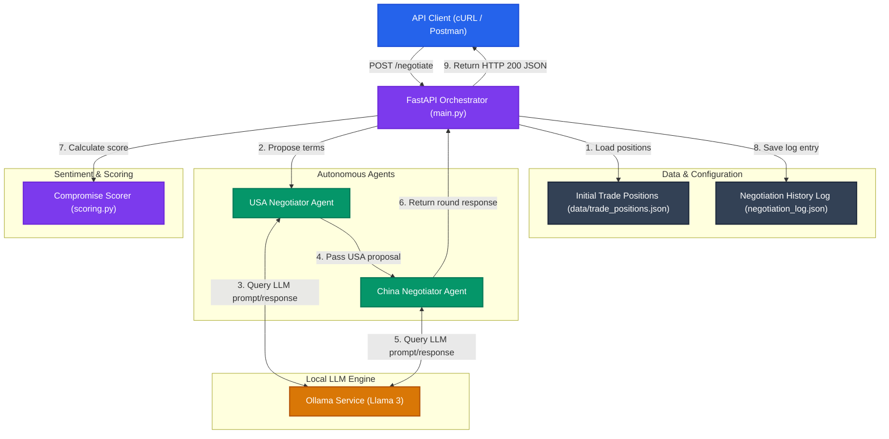

# AI Trade Negotiation Simulator

An autonomous multi-agent system where AI agents representing the **USA** and **China** negotiate multi-round trade agreements using **Ollama (Llama 3)**, **FastAPI**, and **Docker**.

## System Architecture



### Core Components

- **USA Negotiator Agent**: Driven by persona rules and initial priorities (technology tariff reductions, IP protection).
- **China Negotiator Agent**: Driven by persona rules and initial priorities (agricultural market access, technology transfer restrictions).
- **Compromise Scorer**: Heuristic module evaluating concession vs. combative sentiment to output a normalized compromise score `[0.0, 1.0]`.
- **State Logger**: Automatically persists completed negotiation history and outcome metrics to `negotiation_log.json`.

---

## One-Command Quickstart

Start the entire environment (FastAPI backend + Ollama LLM service) with a single command:

```bash
docker-compose up --build
```

The API service will be accessible at `http://localhost:8000`.

---

## Environment Configuration

An `.env.example` file is provided in the repository root:

```env
OLLAMA_BASE_URL=http://ollama:11434
```

Copy `.env.example` to `.env` if local customization is needed:

```bash
cp .env.example .env
```

---

## API Reference

### Initiate Negotiation

**Endpoint**: `POST /negotiate`  
**Content-Type**: `application/json`

#### Request Body
```json
{
  "issue": "Semiconductor Import Tariffs",
  "rounds": 3
}
```

#### Success Response (`200 OK`)
```json
{
  "rounds": [
    {
      "round": 1,
      "usa_proposal": "The USA proposes to reduce tariffs on technology products and strengthen intellectual property (IP) protection clauses.",
      "china_response": "China agrees to negotiate provided we gain greater market access for agricultural products."
    },
    {
      "round": 2,
      "usa_proposal": "The USA agrees to grant market access for agricultural products if IP protections are strictly enforced.",
      "china_response": "China accepts lower tariffs and agrees to mutual intellectual property safeguards."
    },
    {
      "round": 3,
      "usa_proposal": "The USA confirms the reduced tariff schedule and IP protection terms.",
      "china_response": "China signs the agreement based on agricultural access and technology transfer terms."
    }
  ],
  "outcome": {
    "agreement_reached": true,
    "final_terms": "Agreement reached on Semiconductor Import Tariffs...",
    "compromise_score": 0.78
  }
}
```

---

## Configuration & Customization

Agent priorities and flexibilities are loaded dynamically at runtime from `data/trade_positions.json`:

```json
{
  "usa": {
    "priorities": [
      "Reduce tariffs on technology products",
      "Strengthen intellectual property (IP) protection clauses"
    ],
    "flexibility": {
      "tariffs": 0.7,
      "ip_protection": 0.3
    }
  },
  "china": {
    "priorities": [
      "Gain greater market access for agricultural products",
      "Limit restrictions on technology transfer"
    ],
    "flexibility": {
      "market_access": 0.8,
      "tech_transfer_limits": 0.4
    }
  }
}
```

---

## Automated Testing

Run pytest suite locally or inside the API container:

### Local Execution
```bash
python -m pytest
```

### Docker Execution
```bash
docker-compose exec api pytest
```

The test suite validates:
- Endpoint schema adherence and status code `200 OK`.
- Dynamic iteration length (`rounds` array length matches request).
- Priority keyword presence in generated proposals.
- Normalized compromise score boundaries `[0.0, 1.0]`.

---

## Folder Structure

```
AI-Trade-Negotiation-Simulator/
├── agents/
│   ├── __init__.py
│   └── negotiator.py         # Core Negotiator agent class & Ollama integration
├── data/
│   └── trade_positions.json  # Declarative agent trade positions & priorities
├── tests/
│   ├── __init__.py
│   └── test_negotiation.py   # Pytest suite for API endpoints and priority verification
├── .dockerignore              # Files ignored by Docker build context
├── .env.example               # Environment variable template
├── .gitignore                 # Files ignored by Git
├── Dockerfile                 # FastAPI service container definition
├── docker-compose.yml         # Container orchestration (API + Ollama)
├── main.py                    # FastAPI application entry point & orchestrator loop
├── requirements.txt           # Python dependencies
├── scoring.py                 # Heuristic compromise scoring & state logger
└── README.md                  # Comprehensive project documentation
```
